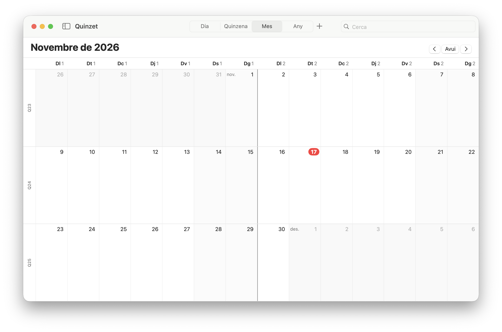

# Quinzet

[Català](#català) · [English](#english)

---

## Català

**Quinzet** és un calendari per a macOS amb vista **quinzenal**: 14 columnes, de *Dilluns 1* a *Diumenge 2*. Fa servir els **mateixos calendaris que l'app Calendari** (iCloud, Google, Exchange, subscripcions, aniversaris...), de manera que tot el que hi facis queda sincronitzat amb Calendari, l'iPhone, etc. La interfície és **bilingüe: català i anglès**, segons l'idioma del sistema.

### Característiques

- Vistes **Dia**, **Quinzena**, **Mes** (files de quinzenes) i **Any** (`Cmd+1` a `Cmd+4`).
- Navegació amb `Cmd+Esquerra` i `Cmd+Dreta`, **Avui** amb `Cmd+T` i mini calendari a la barra lateral.
- Crear esdeveniments amb doble clic a una franja horària, a la fila de "tot el dia" o a un dia del mes, o amb `Cmd+N`.
- Editar títol, ubicació, dates, repetició (inclosa **cada quinzena**), avís, calendari, URL i notes.
- Moure esdeveniments arrossegant-los, també entre dies, i canviar-ne la durada arrossegant la vora inferior.
- Eliminar amb `Retrocés`; als periòdics, pregunta si només aquest o també els futurs.
- Mostrar i amagar calendaris, crear-ne de nous, eliminar-los i subscriure's a calendaris en línia (`Opció+Cmd+S`).
- Cerca d'esdeveniments a la barra d'eines.
- Menú contextual sobre un esdeveniment: obrir-lo, anar a la seva quinzena o eliminar-lo; i a la vista de mes i any, obrir la quinzena d'un dia amb un clic.
- Repetició amb final opcional (mai o en una data), avís configurable i triar a quin calendari va cada esdeveniment.
- Nous calendaris amb color i compte a triar.
- Configuració: primer dia de la quinzena, calendari per defecte per als esdeveniments nous i botó per restablir els valors per defecte.
- Numeració de quinzenes (Q1, Q2...) a partir de la que conté l'1 de gener.
- **Interfície en català i en anglès**, tant els menús i els diàlegs com els noms de dies i mesos i el format de les dates.
- El primer dia de la quinzena és configurable a Configuració (`Cmd+,`); per defecte, el 12 d'octubre de 2026 és un *Dilluns 1*.

### Captura de pantalla



### Idioma

Quinzet s'obre en l'idioma del sistema: català si el teu Mac és en català, i anglès en qualsevol altre cas. Per canviar-lo només per a Quinzet, ves a Configuració del Sistema, General, Idioma i regió, Aplicacions, i afegeix-hi Quinzet amb l'idioma que vulguis. Cal tornar a obrir l'app.

### Requisits

- macOS 14 (Sonoma) o posterior.
- Xcode (instal·lat des de l'App Store) per compilar-lo; les Command Line Tools soles no hi arriben amb el SDK de macOS 27.

### Instal·lació

```bash
git clone https://github.com/albertbosch/quinzet.git
cd quinzet
./build.sh
```

`build.sh` compila l'app, en crea `Quinzet.app` i `Quinzet.dmg` i obre el DMG: arrossega Quinzet a Aplicacions. El primer cop que l'obris, accepta l'accés als calendaris.

L'app queda signada només de manera local (*ad hoc*) i no està notaritzada. Si macOS l'avisa, fes clic dret sobre l'app, tria Obrir i confirma.

### Limitacions (EventKit)

- No es poden enviar invitacions: els convidats es mostren, però només es poden afegir des de Calendari.
- Les subscripcions es confirmen a l'app Calendari (Quinzet hi envia l'adreça i després les mostra).
- No inclou Recordatoris ni impressió.

### Estructura

```
Sources/Quinzet/   -> codi Swift (SwiftUI i EventKit)
Resources/         -> Info.plist, icona i traduccions (ca.lproj, en.lproj)
Package.swift      -> definició del paquet
build.sh           -> compila i crea Quinzet.app i Quinzet.dmg
```

### Llicència

Aquest projecte està sota llicència [CC BY-NC 4.0](https://creativecommons.org/licenses/by-nc/4.0/deed.ca): pots usar-lo i adaptar-lo citant-ne l'autoria, però no amb finalitats comercials.

---

## English

**Quinzet** is a macOS calendar with a **fortnightly** view: 14 columns, from *Monday 1* to *Sunday 2*. It uses the **same calendars as the Calendar app** (iCloud, Google, Exchange, subscriptions, birthdays...), so everything you do stays in sync with Calendar, your iPhone, and so on. The interface is **bilingual: Catalan and English**, following the system language.

### Features

- **Day**, **Fortnight**, **Month** (rows of fortnights) and **Year** views (`Cmd+1` to `Cmd+4`).
- Navigation with `Cmd+Left` and `Cmd+Right`, **Today** with `Cmd+T`, and a mini calendar in the sidebar.
- Create events by double-clicking a time slot, the "all day" row or a day in the month view, or with `Cmd+N`.
- Edit title, location, dates, repeat (including **every fortnight**), alert, calendar, URL and notes.
- Move events by dragging them, also across days, and change their duration by dragging the bottom edge.
- Delete with `Backspace`; for recurring events, it asks whether to delete only this one or future ones too.
- Show and hide calendars, create new ones, delete them and subscribe to online calendars (`Option+Cmd+S`).
- Event search in the toolbar.
- Context menu on an event: open it, jump to its fortnight or delete it; in the month and year views, open a day's fortnight with a click.
- Repeat with an optional end (never or on a date), configurable alert, and choice of which calendar each event goes to.
- New calendars with a colour and an account of your choice.
- Settings: first day of the fortnight, default calendar for new events and a button to restore the defaults.
- Fortnight numbering (Q1, Q2...) starting from the one that contains January 1st.
- **Catalan and English interface**, covering menus and dialogs as well as day and month names and date formats.
- The first day of the fortnight is configurable in Settings (`Cmd+,`); by default, October 12, 2026 is a *Monday 1*.

### Screenshot


### Language

Quinzet opens in the system language: Catalan if your Mac is set to Catalan, and English otherwise. To change it for Quinzet only, go to System Settings, General, Language & Region, Applications, and add Quinzet with the language you want. Restart the app afterwards.

### Requirements

- macOS 14 (Sonoma) or later.
- Xcode (installed from the App Store) to build it; the Command Line Tools alone are not enough with the macOS 27 SDK.

### Installation

```bash
git clone https://github.com/albertbosch/quinzet.git
cd quinzet
./build.sh
```

`build.sh` builds the app, creates `Quinzet.app` and `Quinzet.dmg`, and opens the DMG: drag Quinzet to Applications. The first time you open it, grant access to your calendars.

The app is only signed locally (*ad hoc*) and is not notarized. If macOS warns you, right-click the app, choose Open and confirm.

### Limitations (EventKit)

- Invitations cannot be sent: guests are shown, but can only be added from Calendar.
- Subscriptions are confirmed in the Calendar app (Quinzet sends it the address and then displays them).
- Reminders and printing are not included.

### Structure

```
Sources/Quinzet/   -> Swift code (SwiftUI and EventKit)
Resources/         -> Info.plist, icon and translations (ca.lproj, en.lproj)
Package.swift      -> package definition
build.sh           -> builds and creates Quinzet.app and Quinzet.dmg
```

### License

This project is licensed under [CC BY-NC 4.0](https://creativecommons.org/licenses/by-nc/4.0/): you may use and adapt it with attribution, but not for commercial purposes.
